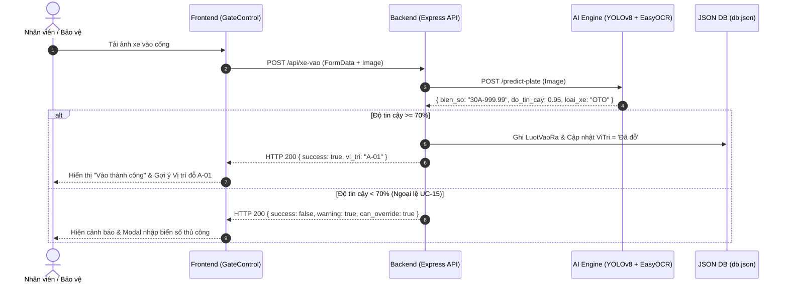

# 🚗 DoXeAI System - Cẩm Nang Phát Triển & Vận Hành Bãi Đỗ Xe Thông Minh

Skill này đóng vai trò là kim chỉ nam kỹ thuật toàn diện, quy định cấu trúc kiến trúc, quy tắc nghiệp vụ cốt lõi, quy trình tương tác fullstack, tập hợp prompt mẫu chuẩn hóa và checklist kiểm thử cho hệ thống DoXeAI.

---

## 1. Mục Đích & Phạm Vi (Purpose & Scope)

- **Mục đích:**
  - Hướng dẫn phát triển, bảo trì và mở rộng tính năng cho toàn bộ hệ thống Quản lý Bãi đỗ xe thông minh DoXeAI.
  - Chuẩn hóa luồng kiểm soát xe Vào / Ra tích hợp công nghệ thị giác máy tính AI (YOLOv8 + OCR + EasyOCR fallback).
  - Cung cấp mô hình ngôn ngữ tự nhiên (NLP) phân tích số liệu điều hành cho Trợ lý ảo Quản trị viên (UC-12, UC-13, UC-14).
  - Định hình trải nghiệm giao diện người dùng hiện đại, sắc nét (Dark Modern Glassmorphism) cho ban quản lý và khách hàng cư dân.

- **Phạm vi áp dụng:**
  - **Backend (`backend/`)**: Node.js, Express.js (Port 5000), Local JSON DB (`data/db.json`), `services/aiService.js`, `services/aiAssistantService.js`, Controllers & Routes.
  - **Frontend (`frontend/`)**: React 18, Vite (Port 5173), Tailwind CSS, Lucide Icons, `GateControl.jsx`, `ParkingMap.jsx`, `Dashboard.jsx`, `AiAssistantWidget.jsx`, `CustomerPortal.jsx`, `UserManagement.jsx`, `PricingTable.jsx`.
  - **AI Microservice (`ai_engine/`)**: Python FastAPI (Port 8000), mô hình YOLOv8 (`yolov8n.pt`), EasyOCR, tiền xử lý ảnh OpenCV.

---

## 2. Quy Trình Thực Hiện (Workflow Step-by-step)

Hệ thống hoạt động theo 5 bước tuần tự từ khởi động, xử lý nghiệp vụ đến kiểm thử:

1. **Bước 1: Khởi động & Khảo sát Sẵn sàng của Toàn hệ thống**
   - Kiểm tra môi trường Node.js và Python: Khởi chạy toàn bộ hệ thống bằng lệnh monorepo `npm run dev:all` (hoặc `npm run dev` cho Backend + Frontend).
   - Kiểm tra tính hợp lệ của cơ sở dữ liệu `backend/data/db.json` thông qua utility `readDb()`.

2. **Bước 2: Xử lý Luồng Nghiệp vụ Cổng Vào (Check-in Workflow)**
   - Tiếp nhận dữ liệu xe vào từ `GateControl.jsx` qua API `POST /api/xe-vao` (kèm file ảnh hoặc biển số).
   - Gửi ảnh qua `ai_engine` (YOLOv8 + EasyOCR) để trích xuất biển số, loại xe và độ tin cậy `doTinCay`. Nếu AI Engine offline, tự động chuyển sang fallback Tesseract.js / OpenCV heuristic.
   - **Đánh giá độ tin cậy:**
     - Nếu `doTinCay >= 0.70`: Tự động tìm vị trí trống phù hợp (`ViTri` khớp loại xe `OTO` hoặc `XE_MAY`), cập nhật trạng thái `Đã đỗ`, ghi bản ghi vào bảng `LuotVaoRa`.
     - Nếu `doTinCay < 0.70` và chưa có cờ `override`: Kích hoạt nghiệp vụ **UC-15 (Xác nhận thủ công)**, gửi cảnh báo về Frontend để nhân viên/bảo vệ kiểm tra và nhập biển số chuẩn xác.

3. **Bước 3: Xử lý Luồng Nghiệp vụ Cổng Ra & Tính Phí (Check-out Workflow)**
   - Nhân viên quét biển số hoặc tra cứu xe ra tại `POST /api/xe-ra`.
   - Tìm lượt gửi đang mở (`trangThai = "Đang đỗ"`).
   - Tính toán thời gian đỗ thực tế `soGioGui` (làm tròn lên theo quy tắc tối thiểu 1 giờ).
   - **Áp dụng bảng giá:**
     - Vé tháng / Cư dân thường trú (`THUONG_TRU`, `VE_THANG`): Phí = `0 VNĐ`.
     - Xe máy vãng lai: `5.000 VNĐ / lượt`.
     - Ô tô vãng lai: `soGioGui * 20.000 VNĐ / giờ`.
   - Cập nhật lượt thành `Đã ra`, ghi nhận hình thức thanh toán (Tiền mặt / VietQR / Thẻ), giải phóng vị trí `ViTri` về trạng thái `Trống`.

4. **Bước 4: Vận hành Trợ lý Quản trị Thông minh NLP (AI Assistant)**
   - Tiếp nhận câu hỏi ngôn ngữ tự nhiên từ Ban quản lý tại `POST /api/ai-assistant`.
   - Phân loại Intent và tổng hợp số liệu thực tế từ `db.json`:
     - **UC-12**: Phân tích khung giờ cao điểm (07:30 - 09:00, 17:30 - 20:30).
     - **UC-13**: Báo cáo doanh thu hôm nay và cơ cấu dòng tiền (Tiền mặt vs VietQR).
     - **UC-14**: Đề xuất phân bổ nhân sự theo ca trực (Sáng: 1, Chiều: 2, Đêm: 1 bảo vệ).
     - **Sức chứa:** Thống kê tỷ lệ lấp đầy theo từng phân khu (Zone A, B, C, D).

5. **Bước 5: Đồng bộ Giao diện & Kiểm thử Fullstack**
   - Frontend tự động refresh trạng thái các ô đỗ trên `ParkingMap.jsx`, cập nhật biểu đồ tại `Dashboard.jsx`.
   - Đối soát dữ liệu giữa Frontend và Backend để đảm bảo không xảy ra sai lệch số lượng xe hoặc trạng thái ô đỗ.

---

## 3. Nguyên Tắc & Tiêu Chuẩn (Rules & Constraints)

- [ ] **Bảo Toàn Cơ Sở Dữ Liệu:** Luôn sử dụng hàm tiện ích `readDb()` và `writeDb(db)` trong `backend/src/utils/db.js` để thao tác với `data/db.json`, tuyệt đối không ghi file đè trực tiếp để tránh race condition.
- [ ] **Quy Tắc Nhận Diện Biển Số & Ngoại Lệ UC-15:**
  - Nếu AI OCR đạt độ tin cậy `< 0.70`, hệ thống phải từ chối tự động check-in và bật cờ `can_override: true` yêu cầu nhân viên xác thực biển số.
  - Chuẩn hóa định dạng biển số Việt Nam: Ô tô (`30A-123.45`, `51K-999.99`), Xe máy (`29-B1 123.45`, `23-D1 497.07`).
- [ ] **Kiểm Soát Tính Toàn Vẹn Ô Đỗ:** Một vị trí (`ViTri`) chỉ được chứa tối đa 1 xe ở trạng thái `Đang đỗ`. Khi xe ra, ô đỗ bắt buộc phải được chuyển về `Trống`.
- [ ] **Quy Định Tính Phí Chuẩn:**
  - Xe thường trú (vé tháng): Luôn luôn `0 VNĐ`.
  - Xe máy vãng lai: `5.000 VNĐ / lượt`.
  - Ô tô vãng lai: `soGioGui * 20.000 VNĐ / giờ` (tối thiểu tính 1 giờ).
- [ ] **Thiết Kế UI/UX Dark Modern Chuẩn:**
  - Theme nền tối (`bg-slate-950`, `bg-slate-900/60`, viền `border-slate-800`).
  - Màu sắc trạng thái: 🟢 **Emerald** (Trống, Thành công, AI tin cậy >= 70%), 🔴 **Rose/Red** (Đã đỗ, Lỗi, Xe đang gửi), 🟡 **Amber** (Bảo trì, AI < 70%), 🔵 **Blue/Sky** (Ô tô, Nút thao tác chính).
- [ ] **Không Dùng Mock Tĩnh Trong Production:** Các tính năng phải kết nối API thực tế, hiển thị loading spinner và modal thông báo rõ ràng khi thao tác.

---

## 4. Cấu Trúc Đầu Ra / Output Template & Prompt Mẫu

### 📌 4.1. Cấu trúc JSON API Chuẩn

#### A. Kết quả nhận diện AI OCR (`POST /predict-plate` hoặc `nhanDienBienSo`):
```json
{
  "success": true,
  "bien_so": "30H-892.45",
  "do_tin_cay": 0.88,
  "loai_xe": "OTO",
  "box": [120, 240, 450, 310],
  "thoi_gian_xu_ly_ms": 112,
  "engine": "YOLOv8 + EasyOCR"
}
```

#### B. Phản hồi Trợ lý AI Assistant (`POST /api/ai-assistant`):
```json
{
  "topic": "DOANH_THU",
  "intent": "REVENUE_REPORT",
  "summary": "Tổng doanh thu ghi nhận trong ngày đạt 49.430.000 VNĐ.",
  "details": [
    "Tổng số lượt xe đã thanh toán và rời bãi: 32 lượt",
    "Doanh thu từ VietQR/Chuyển khoản: 38.500.000 VNĐ (chiếm 77.9%)",
    "Doanh thu tiền mặt tại quầy: 10.930.000 VNĐ (chiếm 22.1%)"
  ],
  "recommendations": [
    "Khuyến khích tài xế thanh toán không dùng tiền mặt để giảm ùn ứ tại cổng ra.",
    "Bố trí thêm nhân viên hỗ trợ quét mã VietQR vào khung giờ cao điểm 17:30 - 19:30."
  ],
  "stats": {
    "doanhThuNgay": 49430000,
    "soLuotXe": 32,
    "tyLeKhongTienMat": 77.9
  }
}
```

---

### 💻 4.2. Bộ Prompt Mẫu Chuẩn Hóa

#### 🟢 Prompt BE-01: Tạo mới / Tinh chỉnh Endpoint Controller & Route
> **Dùng khi:** Cần tạo thêm API hoặc tối ưu hóa logic nghiệp vụ backend.

```text
[VAI TRÒ]: Bạn là Backend Engineer cấp cao chuyên về Node.js, Express và RESTful API.

[NHIỆM VỤ]: Hãy viết mã nguồn cho endpoint [TÊN_ENDPOINT, ví dụ: POST /api/xe/gia-han-ve-thang] trong hệ thống DoXeAI.

[YÊU CẦU KỸ THUẬT]:
1. Sử dụng hàm readDb() và writeDb(db) từ 'src/utils/db.js'.
2. Validate dữ liệu đầu vào: [Danh sách tham số cần kiểm tra, ví dụ: bienSo, soThangGiaHan].
3. Xử lý lỗi đầy đủ với try-catch:
   - Trả về status 400 nếu dữ liệu thiếu hoặc không hợp lệ.
   - Trả về status 404 nếu không tìm thấy bản ghi.
   - Trả về status 200/201 kèm payload { success: true, message: "...", data: {...} }.
4. Đảm bảo cập nhật chính xác dữ liệu trong db.json.
```

#### 🟢 Prompt BE-02: Nâng Cấp Engine Nhận Diện AI OCR & Xử Lý Ngoại Lệ (UC-15)
> **Dùng khi:** Tinh chỉnh service OCR hoặc tích hợp thêm model AI thực tế.

```text
[VAI TRÒ]: Bạn là Computer Vision & Backend AI Specialist.

[NHIỆM VỤ]: Nâng cấp hàm `nhanDienBienSo(file, options)` trong `backend/services/aiService.js`.

[YÊU CẦU]:
1. Hỗ trợ nhận diện biển số xe ô tô (vuông/dài: 30A-123.45, 51K-999.99) và xe máy (29-B1 123.45).
2. Xử lý ảnh đầu vào: Kiểm tra kích thước, định dạng, độ sáng.
3. Trả về cấu trúc JSON chuẩn:
   {
     "bien_so": string,
     "do_tin_cay": number, // từ 0.00 đến 1.00
     "loai_xe": "OTO" | "XE_MAY",
     "thoi_gian_xu_ly_ms": number
   }
4. Đảm bảo có cơ chế fallback giả lập nếu không kết nối được thư viện OCR ngoài.
```

#### 🟢 Prompt BE-03: Mở Rộng Trí Thức Trợ Lý AI Assistant (UC-12, UC-13, UC-14)
> **Dùng khi:** Thêm các câu hỏi điều hành mới vào `aiAssistantService.js`.

```text
[VAI TRÒ]: Bạn là AI NLP Engineer chuyên xử lý câu hỏi ngữ nghĩa cho hệ thống quản trị bãi xe.

[NHIỆM VỤ]: Bổ sung intent phân tích mới vào `processAdminQuery(prompt)` trong `backend/src/services/aiAssistantService.js`.

[YÊU CẦU]:
1. Nhận diện các từ khóa câu hỏi của Admin (ví dụ: "bảo trì", "tỷ lệ hư hỏng", "doanh thu tháng").
2. Đọc và tổng hợp trực tiếp từ các bảng trong db.json: ViTri, LuotVaoRa, Xe, BangGia.
3. Cấu trúc câu trả lời trả về:
   - topic: Tên chủ đề use case.
   - intent: Mã định danh viết hoa (VD: MAINTENANCE_ANALYTICS).
   - summary: Tóm tắt 1 câu ngắn gọn.
   - details: Mảng các gạch đầu dòng có số liệu chi tiết.
   - recommendations: Mảng các đề xuất hành động thực tiễn cho Ban quản lý.
   - stats: Object chứa các chỉ số KPI then chốt.
```

#### 🔵 Prompt FE-01: Thiết Kế / Cải Tiến Component UI với React & Tailwind
> **Dùng khi:** Tạo mới hoặc làm đẹp giao diện một Component.

```text
[VAI TRÒ]: Bạn là Frontend UI/UX Master chuyên sâu về React, Tailwind CSS và Lucide Icons.

[NHIỆM VỤ]: Xây dựng / Nâng cấp Component [TÊN_COMPONENT, ví dụ: GateControl.jsx / ParkingMap.jsx].

[YÊU CẦU THIẾT KẾ]:
1. Phong cách: Dark Modern Theme (slate-950, slate-900, viền slate-800/80, shadow cao cấp).
2. Tương tác: Hover effects, transition mượt mà, micro-animations, loading spinner khi gọi API.
3. Dùng đầy đủ icon từ 'lucide-react' phù hợp với ngữ cảnh quản lý bãi đỗ xe.
4. Xử lý trạng thái: Empty state, Error alert, Modal xác nhận thao tác.
5. Responsive: Tối ưu trên cả màn hình lớn (Desktop 1920x1080) và máy tính bảng bốt bảo vệ (Tablet).
```

#### 🔵 Prompt FE-02: Nâng Cấp Trải Nghiệm Cổng Kiểm Soát & Camera OCR (GateControl UX)
> **Dùng khi:** Tối ưu hóa màn hình soát vé Cổng Vào / Cổng Ra (UC-01, UC-02, UC-15).

```text
[VAI TRÒ]: Bạn là Frontend Engineer chuyên về luồng nghiệp vụ tương tác thiết bị IoT & AI Camera.

[NHIỆM VỤ]: Hoàn thiện giao diện điều khiển Cổng Vào / Cổng Ra tại `frontend/src/components/GateControl.jsx`.

[CÁC TÍNH NĂNG BẮT BUỘC]:
1. Phân chia 2 cột rõ ràng: Cổng Vào (Check-in) và Cổng Ra (Check-out).
2. Tại Cổng Vào:
   - Khung xem trước hình ảnh camera hoặc tải ảnh biển số xe.
   - Hiển thị biển số nhận diện dạng thẻ số dập nổi chân thực.
   - Badge Độ tin cậy AI: Nếu >= 70% hiện màu xanh; nếu < 70% hiện cảnh báo màu đỏ/vàng kèm nút "Nhập tay biển số (Override UC-15)".
   - Tự động gợi ý vị trí ô đỗ còn trống theo loại xe.
3. Tại Cổng Ra:
   - Cho phép tìm nhanh xe bằng cách gõ biển số hoặc chọn từ danh sách xe đang đỗ.
   - Tự động tính thời gian gửi và tiền phí gửi xe theo thời gian thực.
   - Đánh dấu rõ ràng "Vé tháng - 0 VNĐ" nếu xe đã đăng ký thường trú.
   - Nút hoàn tất mở Barrier kèm popup thông báo thanh toán thành công.
```

#### 🔵 Prompt FE-03: Tinh Chỉnh Widget Chatbot Trợ Lý AI (AiAssistantWidget UX)
> **Dùng khi:** Cải thiện giao diện Chatbot Admin nổi.

```text
[VAI TRÒ]: Bạn là Chatbot UI/UX Designer.

[NHIỆM VỤ]: Tối ưu hóa Component `frontend/src/components/AiAssistantWidget.jsx`.

[YÊU CẦU]:
1. Nút mở Chatbot dạng Floating Button có icon Sparkles và hiệu ứng phát sáng gradient tím-xanh.
2. Khi mở Popup chat:
   - Header có avatar AI, trạng thái "Trực tuyến", nút thu nhỏ / đóng.
   - Danh sách gợi ý nhanh (Quick Suggestions) như: "Khung giờ cao điểm?", "Doanh thu hôm nay?", "Bố trí nhân sự?".
   - Tin nhắn trả về từ AI được render thành Card thông tin đẹp mắt: Tóm tắt nổi bật, danh sách chi tiết có icon, hộp Đề xuất hành động màu xanh nhạt.
3. Có âm thanh nhẹ hoặc hiệu ứng typing animation khi AI đang phân tích dữ liệu.
```

---

## 5. Quản Lý Nhật Ký & Lịch Sử (Logging & History)

- **Đường dẫn file lưu trữ dữ liệu lịch sử:**
  - `backend/data/db.json` (bảng `LuotVaoRa` - lưu vết toàn bộ lượt vào ra, biển số, hình ảnh, thời gian, số tiền và độ tin cậy AI).
- **Đường dẫn file log hệ thống (tùy chọn):**
  - `backend/logs/access.log` hoặc console output tiêu chuẩn của `nodemon` và `FastAPI/uvicorn`.
- **Định dạng chuẩn ghi log nghiệp vụ (Event Format):**
  ```text
  [YYYY-MM-DDTHH:mm:ss.sssZ] [EVENT_TYPE] [PLATE] [SLOT_ID] [CONFIDENCE] [FEE] [STATUS]
  ```
  - *Ví dụ Check-in thành công:*
    `[2026-10-02T10:30:50.153Z] [CHECK_IN] [30E-777.96] [A-02] [Conf: 88.0%] [Fee: 0] [SUCCESS]`
  - *Ví dụ Ngoại lệ UC-15 (Độ tin cậy thấp):*
    `[2026-10-02T10:35:12.110Z] [UC_15_OVERRIDE] [29A-688.99] [A-01] [Conf: 62.0%] [Staff: NV_BAOVE] [MANUAL_APPROVED]`
  - *Ví dụ Check-out hoàn tất:*
    `[2026-10-02T10:31:29.514Z] [CHECK_OUT] [12-B1 168.88] [C-01] [Duration: 1h] [Fee: 5000 VND] [Method: TIEN_MAT] [COMPLETED]`

---

## 6. Sơ Đồ Kiến Trúc & Sequence Diagram

### 🏗️ Bản đồ kiến trúc thư mục
```
DoXeAI/
├── ai_engine/                 # Python FastAPI Microservice (Port 8000)
│   ├── main.py                # YOLOv8 + EasyOCR Inference Server
│   ├── yolov8n.pt             # Trọng số mô hình YOLOv8
│   └── requirements.txt       # fastapi, uvicorn, ultralytics, easyocr, opencv-python
│
├── backend/                   # Node.js + Express.js API Server (Port 5000)
│   ├── server.js              # Entry point Express
│   ├── data/db.json           # Cơ sở dữ liệu JSON mô phỏng
│   ├── services/
│   │   ├── aiService.js       # Kết nối YOLOv8 & Fallback Tesseract OCR
│   │   └── aiAssistantService.js # Xử lý ngôn ngữ tự nhiên hỗ trợ Admin (UC-12, 13, 14)
│   └── src/
│       ├── controllers/       # parkingController.js, authController.js
│       ├── routes/            # api.js
│       └── utils/             # db.js (readDb / writeDb)
│
└── frontend/                  # React + Vite + Tailwind CSS (Port 5173)
    ├── src/
    │   ├── App.jsx            # State trung tâm, Auth context, Navigation Tabs
    │   ├── services/api.js    # Client gọi API Backend
    │   └── components/
    │       ├── Dashboard.jsx         # KPI Stats & Biểu đồ tổng quan
    │       ├── GateControl.jsx       # Trạm Cổng Vào / Ra, Camera AI OCR, UC-15 Override
    │       ├── ParkingMap.jsx        # Sơ đồ bãi xe Grid động (Trống / Đã đỗ / Bảo trì)
    │       ├── HistoryLog.jsx        # Nhật ký lượt vào ra & Bộ lọc tìm kiếm
    │       ├── PricingTable.jsx      # Bảng giá dịch vụ theo loại xe & giờ
    │       ├── UserManagement.jsx    # Quản lý tài khoản & phân quyền
    │       ├── CustomerPortal.jsx    # Cổng tra cứu lượt đỗ, vé tháng & VietQR
    │       └── AiAssistantWidget.jsx # Chatbot AI nổi ở góc màn hình
```

### 🔄 Luồng tương tác Fullstack (Sequence Diagram)


---

## 7. Checklist Kiểm Thử Toàn Diện (Fullstack QA Checklist)

### 🔹 Backend Checklist:
- [ ] Khởi chạy máy chủ `npm run dev:backend` tại cổng 5000 thành công.
- [ ] Dữ liệu `data/db.json` được bảo toàn, không bị mất hoặc ghi đè lỗi.
- [ ] API `/api/ai-assistant` xử lý mượt mà cả 3 kịch bản UC-12, UC-13, UC-14.
- [ ] API `/api/xe-ra` tính chính xác: Xe máy = 5k, Ô tô = giờ * 20k, Vé tháng = 0đ.
- [ ] Kết nối mượt mà tới AI Engine cổng 8000, có cơ chế fallback Tesseract nếu AI Engine tắt.

### 🔹 Frontend Checklist:
- [ ] Khởi chạy giao diện `npm run dev:frontend` tại cổng 5173 thành công.
- [ ] Chuyển đổi giữa các tab: Dashboard, Trạm Cổng, Sơ Đồ Ô Đỗ, Lịch Sử, Bảng Giá, Cổng Cư Dân, Tài Khoản không bị giật lag.
- [ ] Thao tác Cổng Vào / Cổng Ra tự động kích hoạt refresh lại danh sách ô đỗ trên Sơ đồ (`ParkingMap`).
- [ ] Widget Chatbot AI hoạt động mượt mà, hiển thị câu trả lời dạng card chi tiết.
- [ ] Modal Xác nhận thủ công UC-15 hiển thị đúng khi độ tin cậy < 70%.
